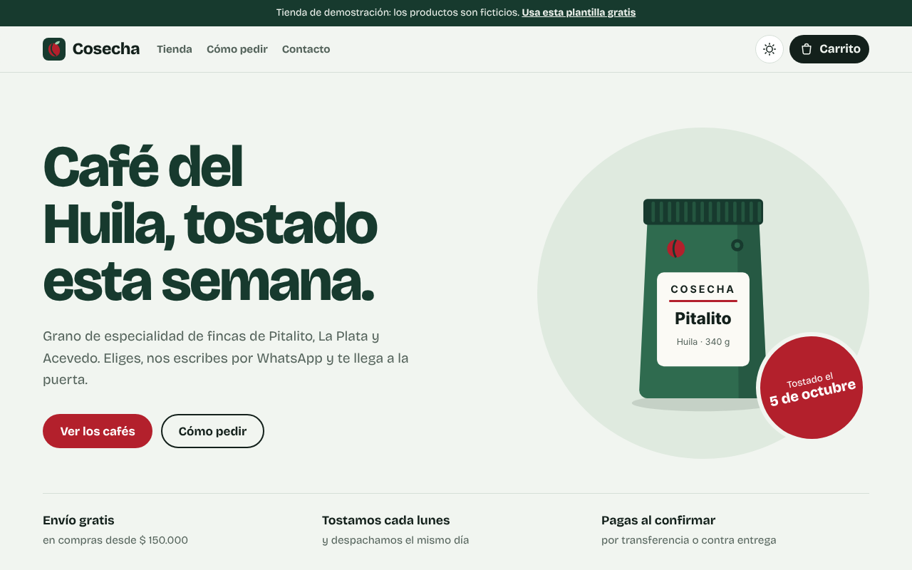

<div align="center">



# Web Shop Starter

**A Spanish-language online store template: catalog, filters, cart and orders through WhatsApp.**
Plain HTML, CSS and JavaScript. No frameworks, nothing to install, free hosting on GitHub Pages.

[](https://alejandromayorca.github.io/Proyecto_Pagina_Web/)
[](LICENSE)
[](https://github.com/AlejandroMayorca/Proyecto_Pagina_Web/actions)
[](package.json)

[Español](README.md) · **English**

</div>

---

Many small businesses in Latin America sell through WhatsApp. This template gives them a proper catalog: customers browse, fill a cart and send a ready-made order message to the store's WhatsApp. The interface and guides are in Spanish; the code is small and easy to translate.

## ✨ Features

- Product catalog with *New* and *Sale* badges, original price and discount percentage.
- Instant search (accent and case insensitive), category filters and sorting, all reflected in the URL so filters can be shared.
- Product details dialog with specs, options (size, color, grind…) and quantity.
- Cart saved in the browser, with a progress bar towards free shipping.
- **Checkout through WhatsApp**: the cart writes the order message with items, total, name and address.
- Automatic light and dark themes, responsive layout, keyboard and screen reader friendly, reduced motion support.
- Everything is configured in two files: [`js/config.js`](js/config.js) (brand, WhatsApp number, currency, shipping) and [`js/productos.js`](js/productos.js) (catalog).
- Self-hosted font, zero dependencies and automated tests (`npm test`).

## 🚀 Quick start

1. Click **Use this template** (or download the ZIP).
2. Open `index.html` in your browser. It works right away.
3. Edit [`js/config.js`](js/config.js) and [`js/productos.js`](js/productos.js).
4. Publish it for free with GitHub Pages: **Settings → Pages → Deploy from a branch → main / root**.

Currency and locale are configurable (`moneda: 'USD'`, `idioma: 'en-US'`), so it works outside Colombia too.

```bash
npm start   # optional local server at http://localhost:3000
npm test    # run the tests
```

## 📄 License

Code under the [MIT License](LICENSE). The bundled [Bricolage Grotesque](https://github.com/ateliertriay/bricolage) font is licensed under the [SIL Open Font License](fonts/OFL-bricolage-grotesque.txt). The *Cosecha* brand and products in the demo are fictional.

Made by **[zPcho](https://github.com/AlejandroMayorca)** · If it helped you, leave a ⭐
