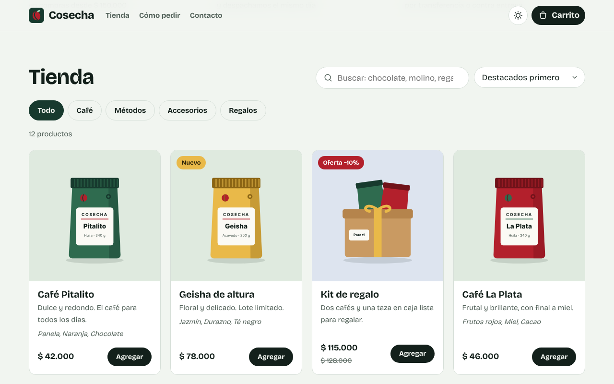
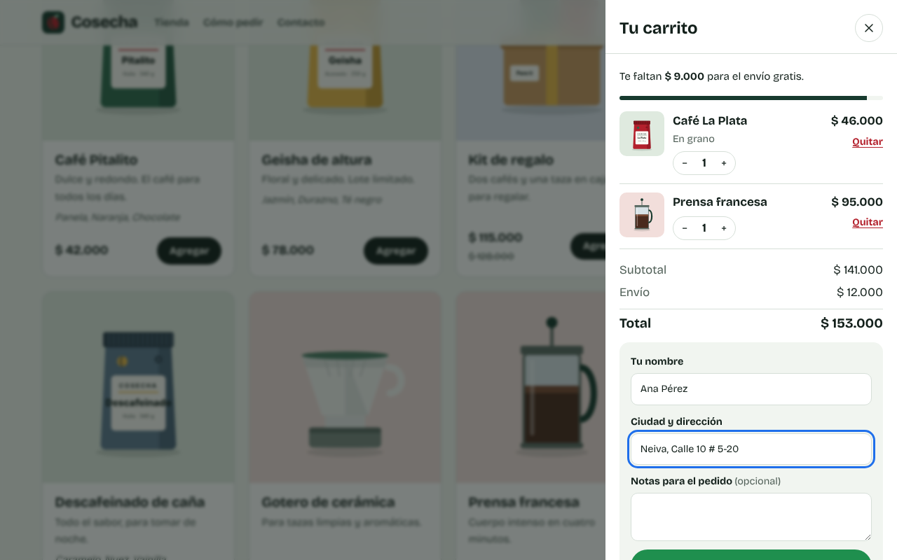
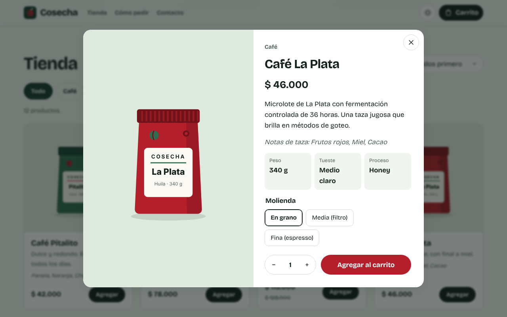
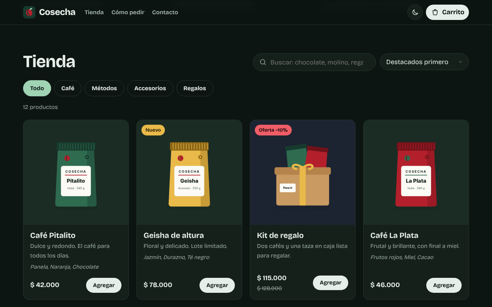

<div align="center">


# Web Shop Starter

**Plantilla de tienda en línea en español: catálogo, filtros, carrito y pedidos por WhatsApp.**
Solo HTML, CSS y JavaScript. Sin frameworks, sin instalar nada y gratis en GitHub Pages.

[](https://alejandromayorca.github.io/Proyecto_Pagina_Web/)
[](LICENSE)
[](https://github.com/AlejandroMayorca/Proyecto_Pagina_Web/actions)
[](package.json)

**Español** · [English](README.en.md)

[Ver la demo](https://alejandromayorca.github.io/Proyecto_Pagina_Web/) · [Guía paso a paso](docs/README.md) · [Agregar productos](docs/03-productos.md) · [Publicar gratis](docs/04-publicar.md)

</div>

---

## ✨ Qué incluye

- 🛍️ **Catálogo** con fotos, etiquetas de *Nuevo* y *Oferta*, precio anterior y porcentaje de descuento.
- 🔎 **Búsqueda instantánea** que ignora tildes y mayúsculas, **filtros por categoría** y **orden** por precio o nombre.
- 🔗 **Filtros en la URL**: puedes compartir un enlace directo a "Café, de menor a mayor precio".
- 🧾 **Ficha de producto** con descripción, detalles, opciones (talla, color, molienda…) y cantidad.
- 🛒 **Carrito** que se guarda en el navegador, con barra de progreso hacia el envío gratis.
- 💬 **Pedido por WhatsApp**: el carrito escribe el mensaje con productos, total, nombre y dirección del cliente.
- 🌗 **Modo claro y oscuro** automático, con botón para cambiarlo.
- 📱 **Diseño adaptable** a celulares, tabletas y computadores.
- ♿ **Accesible**: navegable con teclado, textos para lectores de pantalla y movimiento reducido.
- ⚙️ **Todo se configura en dos archivos**: [`js/config.js`](js/config.js) (tu marca) y [`js/productos.js`](js/productos.js) (tu catálogo).
- ✅ **Pruebas automáticas** de la lógica del carrito y del catálogo.

<table>
<tr>
<td width="50%"></td>
<td width="50%"></td>
</tr>
<tr>
<td width="50%"></td>
<td width="50%"></td>
</tr>
</table>

## 🚀 Empieza en 2 minutos

1. Pulsa **Use this template → Create a new repository** arriba en esta página (o descarga el ZIP en **Code → Download ZIP**).
2. Abre `index.html` con doble clic. **Ya funciona**, no necesitas instalar nada.
3. Cambia el nombre de la tienda y tu número de WhatsApp en [`js/config.js`](js/config.js):

   ```js
   window.TIENDA_CONFIG = {
     nombre: 'Mi Tienda',
     eslogan: 'Ropa urbana · Neiva',
     whatsapp: '573001234567',
     ...
   };
   ```

4. Pon tus productos en [`js/productos.js`](js/productos.js) y tus fotos en `img/productos/`.
5. Publícala gratis con GitHub Pages ([guía](docs/04-publicar.md)).

> ¿Nunca has hecho una página web? Sigue la **[guía paso a paso](docs/README.md)**, empieza desde cero.

## 📚 Guía paso a paso

| | |
|---|---|
| [1 · Empezar](docs/01-empezar.md) | Descargar la plantilla, abrirla y editarla |
| [2 · Personalizar tu marca](docs/02-personalizar.md) | Nombre, WhatsApp, colores, letras, logo y textos |
| [3 · Agregar productos](docs/03-productos.md) | Fotos, precios, ofertas, opciones y categorías |
| [4 · Publicar gratis](docs/04-publicar.md) | GitHub Pages y dominio propio |
| [5 · Ideas para ampliarla](docs/05-ampliar.md) | Pagos en línea, Google Sheets, estadísticas y más |

## 🗂️ Estructura

```text
├── index.html          ← la página: secciones y textos fijos
├── css/styles.css      ← colores, letras y diseño
├── js/
│   ├── config.js       ← ✏️ tu marca, WhatsApp, envío y categorías
│   ├── productos.js    ← ✏️ tu catálogo
│   ├── tienda.js       ← lógica: búsqueda, carrito, totales y mensaje
│   └── app.js          ← dibuja la tienda y responde a los clics
├── img/                ← logo, imágenes de productos y vista previa para redes
├── fonts/              ← tipografía incluida (funciona sin internet)
├── docs/               ← guía paso a paso
├── tests/              ← pruebas automáticas
└── dev-server.js       ← servidor local opcional (npm start)
```

Solo necesitas tocar los archivos marcados con ✏️ para tener tu tienda lista.

## 🧪 Para desarrolladores

No hay dependencias ni paso de compilación. Si tienes [Node.js 22+](https://nodejs.org/es):

```bash
npm start   # servidor local en http://localhost:3000
npm test    # pruebas de la lógica del carrito, el catálogo y el servidor
```

## ❓ Preguntas frecuentes

**¿Cobra comisiones o necesita un servidor?**
No. Es una página estática: la publicas gratis en GitHub Pages, Netlify o cualquier hosting, y los pedidos llegan a tu WhatsApp.

**¿Puedo cobrar con tarjeta?**
La plantilla confirma el pago por WhatsApp (transferencia, Nequi, contra entrega…). En [Ideas para ampliarla](docs/05-ampliar.md#pagos-en-línea) explicamos cómo agregar un botón de pago.

**¿Puedo usarla para un cliente?**
Sí. La licencia [MIT](LICENSE) permite uso comercial. Solo conserva el aviso de licencia.

## 🤝 Contribuir

¿Encontraste un error o tienes una idea? [Abre un issue](https://github.com/AlejandroMayorca/Proyecto_Pagina_Web/issues/new/choose) o envía un pull request. Lee [CONTRIBUTING.md](CONTRIBUTING.md): está explicado paso a paso.

Si te sirvió, dale una ⭐ para que más personas la encuentren.

## 📄 Licencia

Código bajo licencia [MIT](LICENSE). La tipografía [Bricolage Grotesque](https://github.com/ateliertriay/bricolage) se incluye bajo la [SIL Open Font License](fonts/OFL-bricolage-grotesque.txt). Los productos y la marca *Cosecha* de la demo son ficticios.

<div align="center">

Creado por **[zPcho](https://github.com/AlejandroMayorca)**

</div>
